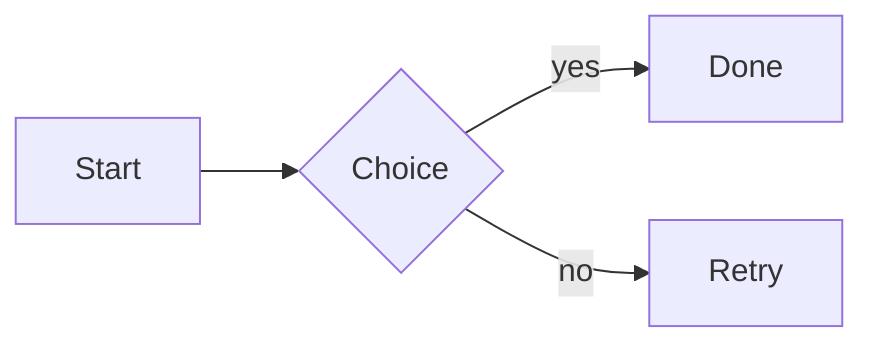
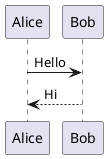

# Markdown showcase

## Second section

## Second section

[[toc]]

Jump to the [second section](#second-section) below.

A paragraph with **bold**, *em*, ~~strike~~ and `code`, a bare URL https://example.com/bare and emoji :tada: :rocket:. Inline math $e^{i\pi}+1=0$ sits in the line.

$$\int_0^1 x\,dx$$

Malformed display math follows:

$$\frac{1}{$$

> [!NOTE]
> A note alert.

> [!TIP]
> A tip alert.

> [!IMPORTANT]
> An important alert.

> [!WARNING]
> A warning alert.

> [!CAUTION]
> A caution alert.

A footnote reference[^1] and a link around one: [see[^1]](https://example.com).

[^1]: The footnote definition.

- [x] a finished task
- [ ] an open task

| Column 1 heading is long | Column 2 heading is long | Column 3 heading is long | Column 4 heading is long | Column 5 heading is long | Column 6 heading is long | Column 7 heading is long | Column 8 heading is long | Column 9 heading is long |
|---|---|---|---|---|---|---|---|---|
| row 1 cell 1 with some filler text | row 1 cell 2 with some filler text | row 1 cell 3 with some filler text | row 1 cell 4 with some filler text | row 1 cell 5 with some filler text | row 1 cell 6 with some filler text | row 1 cell 7 with some filler text | row 1 cell 8 with some filler text | row 1 cell 9 with some filler text |
| row 2 cell 1 with some filler text | row 2 cell 2 with some filler text | row 2 cell 3 with some filler text | row 2 cell 4 with some filler text | row 2 cell 5 with some filler text | row 2 cell 6 with some filler text | row 2 cell 7 with some filler text | row 2 cell 8 with some filler text | row 2 cell 9 with some filler text |
| row 3 cell 1 with some filler text | row 3 cell 2 with some filler text | row 3 cell 3 with some filler text | row 3 cell 4 with some filler text | row 3 cell 5 with some filler text | row 3 cell 6 with some filler text | row 3 cell 7 with some filler text | row 3 cell 8 with some filler text | row 3 cell 9 with some filler text |

```rust
fn main() {
    let wide_line = ["value_001", "value_002", "value_003", "value_004", "value_005", "value_006", "value_007", "value_008", "value_009", "value_010", "value_011", "value_012", "value_013", "value_014", "value_015", "value_016", "value_017", "value_018", "value_019", "value_020"]; // padded out to well over two hundred columns
}
```





<p align="center"></p>

<details><summary>More</summary>hidden</details>


Tail line 1: scrolling needs a long page.
Tail line 2: scrolling needs a long page.
Tail line 3: scrolling needs a long page.
Tail line 4: scrolling needs a long page.
Tail line 5: scrolling needs a long page.
Tail line 6: scrolling needs a long page.
Tail line 7: scrolling needs a long page.
Tail line 8: scrolling needs a long page.
Tail line 9: scrolling needs a long page.
Tail line 10: scrolling needs a long page.
Tail line 11: scrolling needs a long page.
Tail line 12: scrolling needs a long page.
Tail line 13: scrolling needs a long page.
Tail line 14: scrolling needs a long page.
Tail line 15: scrolling needs a long page.
Tail line 16: scrolling needs a long page.
Tail line 17: scrolling needs a long page.
Tail line 18: scrolling needs a long page.
Tail line 19: scrolling needs a long page.
Tail line 20: scrolling needs a long page.
Tail line 21: scrolling needs a long page.
Tail line 22: scrolling needs a long page.
Tail line 23: scrolling needs a long page.
Tail line 24: scrolling needs a long page.
Tail line 25: scrolling needs a long page.
Tail line 26: scrolling needs a long page.
Tail line 27: scrolling needs a long page.
Tail line 28: scrolling needs a long page.
Tail line 29: scrolling needs a long page.
Tail line 30: scrolling needs a long page.
Tail line 31: scrolling needs a long page.
Tail line 32: scrolling needs a long page.
Tail line 33: scrolling needs a long page.
Tail line 34: scrolling needs a long page.
Tail line 35: scrolling needs a long page.
Tail line 36: scrolling needs a long page.
Tail line 37: scrolling needs a long page.
Tail line 38: scrolling needs a long page.
Tail line 39: scrolling needs a long page.
Tail line 40: scrolling needs a long page.
Tail line 41: scrolling needs a long page.
Tail line 42: scrolling needs a long page.
Tail line 43: scrolling needs a long page.
Tail line 44: scrolling needs a long page.
Tail line 45: scrolling needs a long page.
Tail line 46: scrolling needs a long page.
Tail line 47: scrolling needs a long page.
Tail line 48: scrolling needs a long page.
Tail line 49: scrolling needs a long page.
Tail line 50: scrolling needs a long page.
Tail line 51: scrolling needs a long page.
Tail line 52: scrolling needs a long page.
Tail line 53: scrolling needs a long page.
Tail line 54: scrolling needs a long page.
Tail line 55: scrolling needs a long page.
Tail line 56: scrolling needs a long page.
Tail line 57: scrolling needs a long page.
Tail line 58: scrolling needs a long page.
Tail line 59: scrolling needs a long page.
Tail line 60: scrolling needs a long page.
